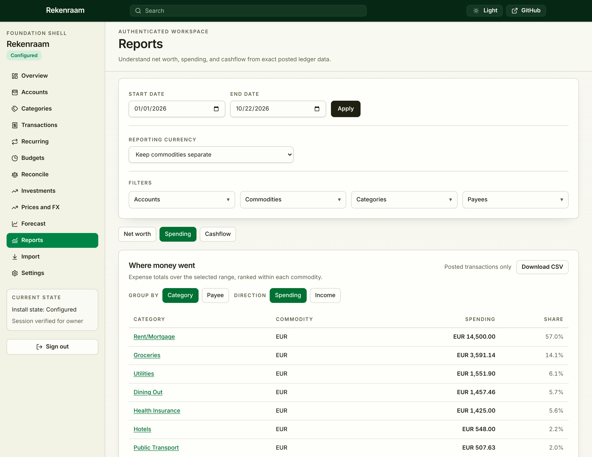

# Rekenraam

A personal finance app you run yourself. It keeps a proper double-entry ledger
of your accounts, cards, savings and investments, in as many currencies as you
actually use, and it lives on your own machine or server rather than someone
else's cloud.

*Rekenraam* is Dutch for abacus.



## Why you might want it

If you miss Microsoft Money or Quicken, find GnuCash too much like bookkeeping
software, or have outgrown budgeting apps that only think in one currency,
Rekenraam is aimed at you.

- **Your data stays with you.** One program and one SQLite file. No account to
  sign up for, no bank-scraping middleman, no subscription. Run it on a laptop,
  a home server or a small VPS.
- **The numbers are exact.** Every amount is stored as an exact decimal, never a
  floating-point approximation, and every transaction balances. Balances,
  reports and gains are computed from the ledger, so they agree with each other.
- **Multi-currency is built in, not bolted on.** Hold euros, dollars and pounds
  side by side. Reports keep each currency separate by default and can restate
  everything into one currency when you ask, using rates you can see and edit.
- **Nothing is silently rewritten.** Posted transactions are versioned. Fixing a
  mistake creates a correction you can trace, and reconciled history stays
  reconciled.
- **Investments are tracked properly.** Lots, cost basis, dividends, splits,
  transfers between brokers, realized and unrealized gains, and period
  statements you can save and reopen later.
- **You can always leave.** Export your ledger to CSV or QIF, or take a full
  archive that contains enough to recompute every balance, lot and gain.

## What it does today

- Accounts, categories and payees, grouped by institution
- Transaction entry with splits and transfers, on desktop and phone
- CSV and QIF import with saved column profiles and duplicate detection
- Optional Trading 212 connection for cash, trades and dividends
- Statement reconciliation
- Net worth, spending and cashflow reports with drill-down, charts and CSV
- Monthly budgets per category and currency
- Recurring transactions you review before they post
- Projected balances from recurring items and your past spending
- Investment holdings, prices and exchange rates, with optional quote providers
- Nightly verified backups, one-command restore, and exports
- Two-factor sign-in and read-only API tokens for your own scripts
- English, plus draft Dutch, German, French, Spanish and Russian translations

Rekenraam is a single-user app: one owner per installation. It is still a
**pre-release**. Expect rough edges, take backups, and check the
[feature ledger](docs/implemented.md) for exactly what ships.

## Try it

The quickest route is Docker Compose. Pick a random setup token of at least
32 characters first; you'll enter it in the browser to create the owner account.

```sh
export SETUP_TOKEN="$(openssl rand -hex 32)"
docker compose -f deploy/docker/compose.yaml up --build
```

Then open <http://127.0.0.1:16888>. The example only listens on localhost.

Before you put real money in it:

- Set `REKENRAAM_SECRET_KEY` to a durable secret before connecting online
  providers or turning on two-factor sign-in, and keep it somewhere other than
  your backups.
- For access from other devices, put it behind HTTPS. The
  [deployment security guide](docs/deployment-security.md) walks through it.
  Enrol in two-factor sign-in before exposing it to the internet.
- Read the [upgrade and restore guide](docs/upgrades.md) before upgrading an
  installation you care about.

Quote providers are optional and bring-your-own-key: set
`COINGECKO_DEMO_API_KEY` or `TWELVE_DATA_API_KEY`, then assign them to
instruments under Investments → Instruments. Details are in the
[quote provider notes](docs/plans/quote-providers-crypto-plan.md).

## Backups and exports

These are two different things, and only one of them gets your data back.

- **Backups** (Settings → Data → Backups) are complete copies of everything:
  ledger, investments, budgets, recurring items, reconciliations and settings.
  Rekenraam makes one every night and on request, and verifies each before
  keeping it. Restore with `rekenraam restore --from <backup>`.
- **Exports** (Settings → Data → Export) are ledger CSV, QIF, or a full archive
  for spreadsheets and other finance tools. They are for reading elsewhere and
  **cannot be imported back** into Rekenraam. Use a backup for that.

## Development

The backend is Go with SQLite, the frontend is SvelteKit, and production is a
single Go binary that serves the built frontend.

You'll need Go 1.27.3+ (with CGO and a C compiler, e.g.
`sudo apt install build-essential`), Node 24 and the pnpm version pinned in
`package.json`.

```sh
pnpm install
pnpm dev          # http://localhost:1888, API proxied to 127.0.0.1:16888
```

Checks and build:

```sh
./scripts/test-backend.sh      # gofmt, vet, race tests
./scripts/test-frontend.sh     # catalog parity, API types, Svelte checks, unit tests
./scripts/test-e2e-smoke.sh    # provider stub tests + browser smoke suite
pnpm build                     # writes dist/rekenraam
```

The full browser suite is `./scripts/test-e2e.sh`. Everything else — focused Go
commands, Go cache settings, E2E timing, the API contract audit, resetting a
disposable dev database, local password recovery — is in the
[developer workflow](docs/developer-workflow.md).

| Path | What's there |
|---|---|
| `backend/` | Go server, services, SQLite migrations, tests |
| `frontend/` | SvelteKit app, compiled for embedding |
| `api/` | OpenAPI contract and Bruno requests |
| `e2e/` | Playwright browser journeys |
| `deploy/` | Docker build and Compose example |
| `scripts/` | Dev, validation and build commands |
| `docs/` | Requirements, decisions, plans and status |

Start with the [documentation map](docs/README.md). The
[roadmap](docs/roadmap.md) sets the work order, open work is tracked in
[GitHub Issues](https://github.com/sergeyfarin/rekenraam/issues), and product
and architecture decisions live in the
[requirements](docs/product-requirements.md),
[conventions](docs/conventions.md) and [ADRs](docs/adrs/). Security reports go
through [SECURITY.md](SECURITY.md).

## License

[AGPL-3.0](LICENSE).
